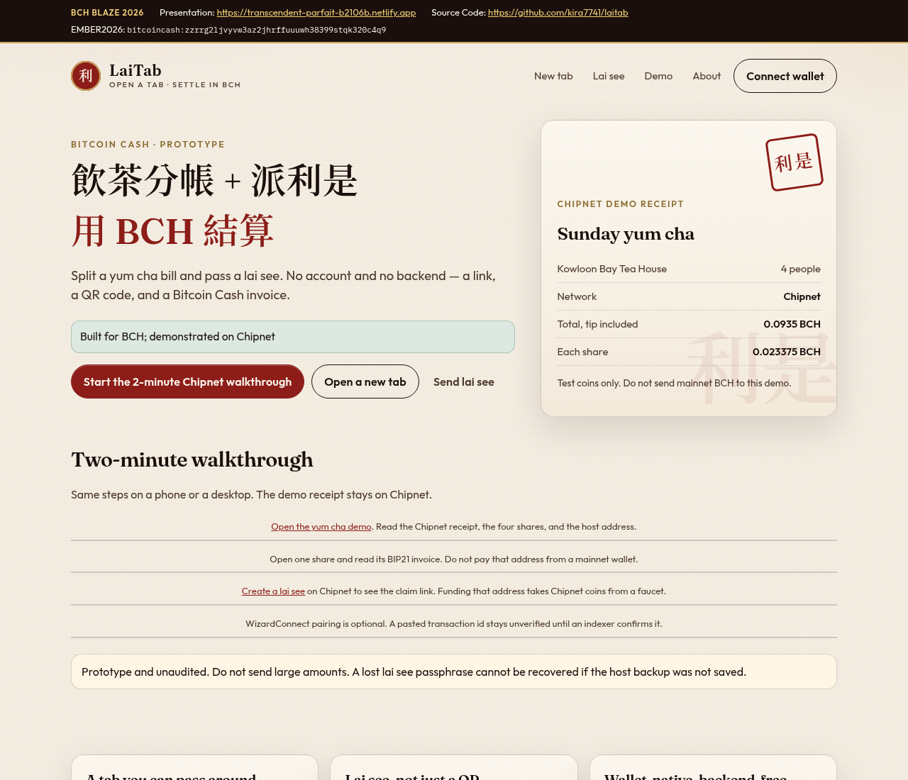
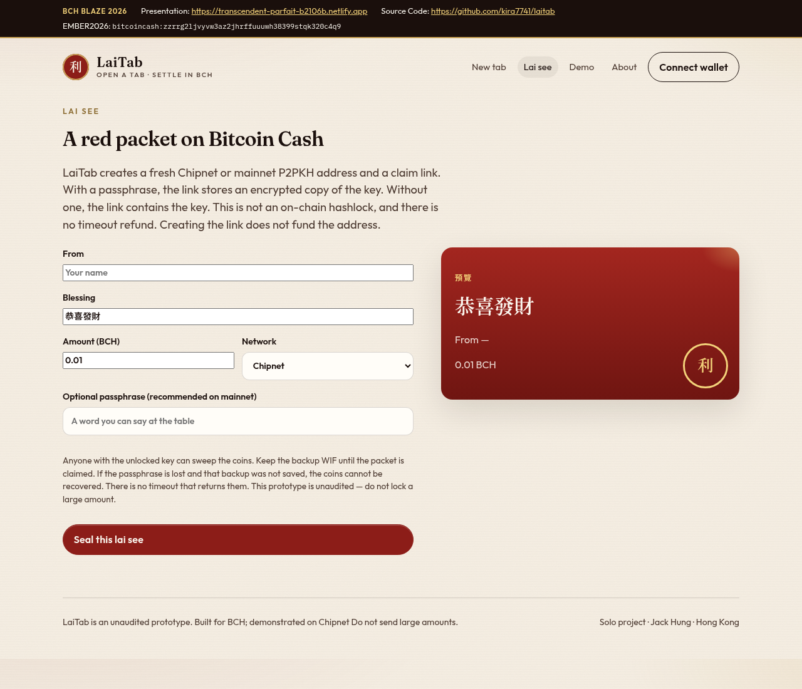
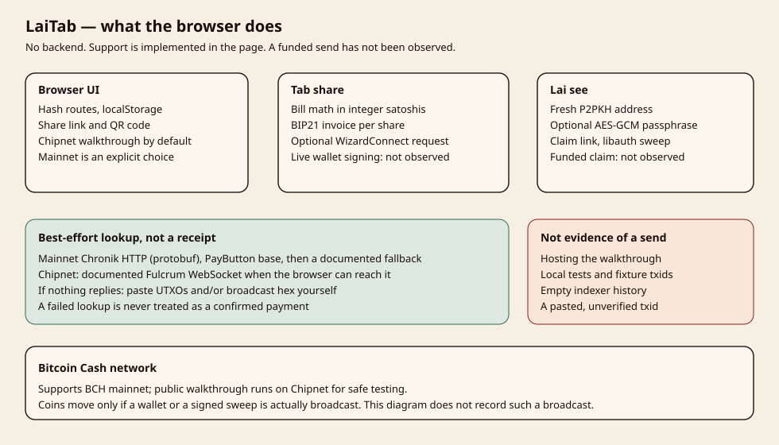

# LaiTab · 利臺

飲茶分帳 + 派利是，用 BCH 結算

Split a yum cha bill and pass a lai see. No account and no backend.

**Built for BCH; demonstrated on Chipnet.**

Prototype and unaudited. Do not send large amounts. A lost lai see passphrase cannot be recovered if the host backup was not saved.

Entrant: **Jack Hung**.

## Status

| What | Where |
| --- | --- |
| Source code | https://github.com/kira7741/laitab |
| Hosted walkthrough | https://gleaming-cheesecake-31e454.netlify.app |
| Deck | https://transcendent-parfait-b2106b.netlify.app |

Banner labels are Presentation, Source Code, and EMBER2026:

- Presentation: https://transcendent-parfait-b2106b.netlify.app
- Source Code: https://github.com/kira7741/laitab
- EMBER2026: `bitcoincash:zzrrg2ljvyvw3az2jhrffuuuwh38399stqk320c4q9`

The hosted walkthrough can lag this repository until a new build is published.

## Evidence ledger

Checked 21 November 2026, 08:59 HKT.

| Check | Result |
| --- | --- |
| `npm test` | 190 passed, 0 failed. Uses fixture txid `000102030405060708090a0b0c0d0e0f101112131415161718191a1b1c1d1e1f` and a synthetic key. The suite does not broadcast. |
| EMBER2026 on PayButton Chronik | Token-aware P2PKH `86342bf26118e8f44a95c694f39c75e27894b058`. `GET /script/p2pkh/…/utxos` returned HTTP 200 and 0 UTXOs. `GET /history` returned HTTP 200 and 0 bytes. |

## How a lai see works

A lai see is a gift key, not an on-chain hashlock.

1. The browser generates a standard P2PKH key with libauth.
2. Funding is a normal payment to that address. The output is ordinary P2PKH. There is no hashlock script, no covenant, and no CashScript contract.
3. The claim link is the packet JSON in the URL.
   - With no passphrase, the JSON includes the WIF.
   - With a passphrase, the WIF is encrypted in the browser: PBKDF2, 120,000 iterations, SHA-256, then AES-GCM. The link stores salt, IV, and ciphertext. The passphrase is not written on-chain.
4. Claiming decrypts the key if needed, checks that it matches the packet address, and signs a P2PKH sweep with libauth.
5. Anyone who has the unlocked key can sweep. Possession of the key is the only lock.
6. There is no timeout refund. Unclaimed coins stay at the packet address until a holder of the key spends them. A CashScript hashlock with a timeout refund is a suggestion, not a feature of this code.

## Wallet signing

- A tab share offers a BIP21 invoice. Any Bitcoin Cash wallet that can pay BIP21 can pay it. LaiTab does not receive that wallet's signature.
- WizardConnect is optional. The sign request is built with `broadcast: false`. If the wallet returns signed hex, LaiTab then tries `broadcastTx`. Pairing alone does not sign or send.
- The request needs coins that carry a locking script and a derivation path from the paired session. The tests cover that shape with a fake wallet object.
- WizardConnect here is the organizers' protocol, not WalletConnect v2, and it does not need a Reown project id.

## Claim lookup and broadcast

`fetchUtxos` then `broadcastTx` in `src/lib/indexer.ts`.

Lookup:

- Mainnet Chronik HTTP, protobuf: `https://bch.paybutton.io/script/p2pkh/{hash160}/utxos`, then `https://chronik.pay2stay.com/bch`. These are Bitcoin Cash paths, not eCash `/xec`. Blockchair is the next mainnet lookup.
- Chipnet has no Chronik HTTP base in this package (`CHIPNET_CHRONIK` is empty). The browser tries Fulcrum at `wss://chipnet.imaginary.cash:50004` (`blockchain.scripthash.listunspent`). Electrum is enabled in the app and disabled in `npm test`.
- `chipnet.imaginary.cash` in the browser is a web explorer, not an Esplora `/api` server.
- If lookup fails, paste `txid:vout:satoshis`. An empty lookup is not treated as a payment.

Broadcast of the signed hex:

- Where a Chronik base exists, `POST {base}/tx` with a protobuf body. Chipnet has no Chronik base, so that loop does not run for Chipnet.
- Mainnet also tries `POST https://api.blockchair.com/bitcoin-cash/push/transaction`.
- Then Fulcrum `blockchain.transaction.broadcast`: Chipnet `wss://chipnet.imaginary.cash:50004`, mainnet `wss://bch.imaginary.cash:50004`.
- If none accept the hex, the claim page shows it for a manual push.

A Chipnet claim in this app uses:

- Chipnet coins on the packet address.
- A UTXO list, from the Chipnet Fulcrum socket or from pasted `txid:vout:satoshis`. A blocked WebSocket stops the automatic lookup.
- The unlocked WIF, from the claim link or from the passphrase.
- A destination CashAddr on the same network.
- A broadcast that a Chipnet node accepts: the Fulcrum socket above, or a manual push of the signed hex. There is no Chipnet Chronik or Blockchair push in this code.

## Screenshots

Pictures of the local production build (`npm run build && npm run preview`).






## Architecture



The tab or packet lives in the link and in `localStorage`. A share becomes a BIP21 invoice or an optional WizardConnect sign request. A lai see is a new P2PKH address plus a claim link. The sweep is signed in the browser when someone claims.

## Quick start

```bash
cd laitab
npm install
npm run dev
```

Hash routes: `#/` home, `#/demo` Chipnet yum cha, `#/new` create a tab, `#/lai` create a lai see, `#/about` notes and faucets.

```bash
npm run build
npm run preview
npm test
```

`npm test` covers bill math, CashAddr, passphrase encryption, outpoint byte order, OP_RETURN memos, mocked indexers, and the WizardConnect sign-request shape.

`npm run pack` writes a source zip beside the project and excludes `node_modules`, `dist`, and `.env`.

## Try the demo without a wallet

Open `#/demo`. Four people at a Kowloon Bay tea house, total **0.0935 BCH** on Chipnet including a 10% tip, **0.023375 BCH** each. The receipt, BIP21 codes, and share link can be read without paying.

The demo host address is derived from `SHA-256("laitab-demo-host-v1")`:

```
bchtest:qzqxmu8z2c3tgtut8f5sw6t6fe92p87pccwre396hc
```

**Do not send mainnet BCH there.** Chipnet coins sent there can be recovered with the WIF below. Reset from the demo banner, or open `#/demo/reset`.

Demo host WIF, Chipnet demo only. Never use this key to receive or store mainnet funds.

```
cNPeucZGUi3sWYNXEGacoz3QqiyrNki32AJ6n6u1J67RymWyAGxp
```

Chipnet faucets: [tbch.googol.cash](https://tbch.googol.cash/) (select chipnet), [chipnet.bch.ninja](https://chipnet.bch.ninja/). Explorer: [chipnet.imaginary.cash](https://chipnet.imaginary.cash/).

## Project layout

```
src/lib/        money, CashAddr, BIP21, storage, indexer, sweep, passphrase
src/pages/      home, create tab, tab view, lai see, claim, about
src/wallet/     WizardConnect hook and QR dialog
scripts/check.ts
docs/           screenshots and the architecture diagram
```

Notes that used to live beside this folder (`APPROACH.md`, `INDEXER-RESEARCH.md`, `SUBMISSION-CHECKLIST.md`, `WRITEUP.md`) are not in this repository. Indexer behavior is the code in `src/lib/indexer.ts` and the claim section above.
