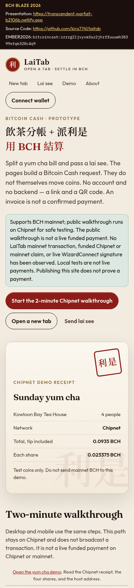
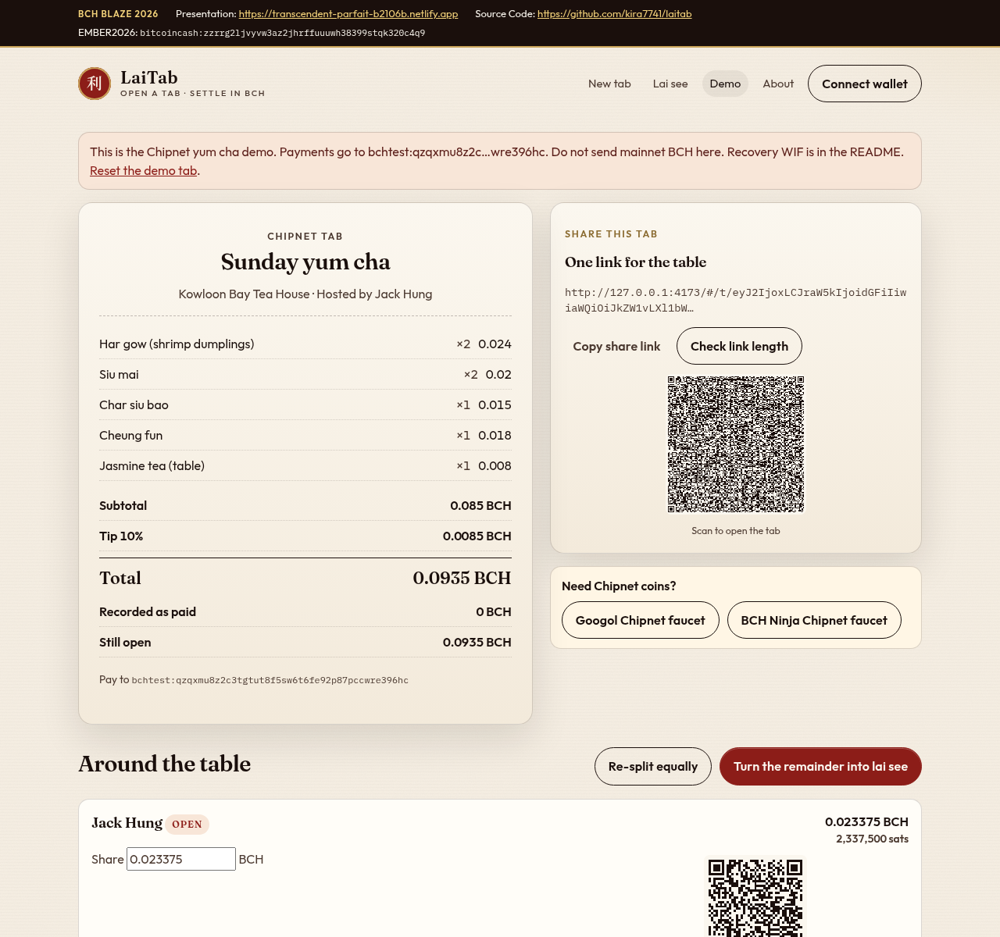

# LaiTab · 利臺

飲茶分帳 + 派利是，用 BCH 結算

Split a yum cha bill and pass a lai see. The app builds a Bitcoin Cash request in the browser. There is no account and no backend.

**Supports BCH mainnet; public walkthrough runs on Chipnet for safe testing.**

The public walkthrough is not a live funded payment. No LaiTab mainnet transaction, funded Chipnet or mainnet claim, or live WizardConnect signature has been observed. Local tests are not live payments. Publishing this site does not prove a payment.

Entrant: **Jack Hung**.

## Public, and not submitted

| What | State |
| --- | --- |
| Source code | Public at https://github.com/kira7741/laitab |
| Hosted walkthrough | Public at https://gleaming-cheesecake-31e454.netlify.app (HTTP 200 on 21 November 2026). This is a static site. Opening it does not broadcast a transaction. The copy on that host may lag this repository until the owner deploys a new build. |
| Deck | Public at https://transcendent-parfait-b2106b.netlify.app (HTTP 200 on 21 November 2026). The deck is edited separately from this repository. |
| BCH BLAZE submission | **Not formally submitted.** Pending owner review and an official Telegram confirmation. Do not treat this repository, the hosted walkthrough, or the deck as that confirmation. |

## Supported code versus observed execution

Implemented in this source, and exercised by `npm test` with fixtures and mocks:

- Chipnet and mainnet CashAddr checks, BIP21 invoices, and integer-satoshi bill splits.
- A lai see P2PKH key, optional AES-GCM passphrase, and a claim link that omits the raw key when locked.
- A libauth P2PKH sweep built from a synthetic key. The test key is `0x01` repeated, and the test transaction id is the synthetic value `000102030405060708090a0b0c0d0e0f101112131415161718191a1b1c1d1e1f`. That id is not broadcast.
- The shape of a WizardConnect signature request, using a fake wallet object.
- Chronik protobuf encode/decode, including a mocked PayButton response. The mock is not a query that found a LaiTab payment.

Not observed, and not claimed:

- No LaiTab mainnet transaction id is stored in this repository. None is invented here.
- A readiness note for 21 November 2026, 08:56 HKT, reports that BCH PayButton Chronik returned zero UTXOs and an empty history for the EMBER2026 address below. An empty history is the absence of a payment, not a payment. An independent read-only check on 21 November 2026 at 08:59 HKT decoded that address as token-aware P2PKH (`86342bf26118e8f44a95c694f39c75e27894b058`) and called `https://bch.paybutton.io/script/p2pkh/86342bf26118e8f44a95c694f39c75e27894b058/utxos`. Chronik returned HTTP 200 protobuf. This repository's `decodeScriptUtxos` counted 0 UTXOs and 0 skipped token outputs. The matching `/history` URL returned HTTP 200 with a 0-byte body, so there was no history payload to decode. Nothing was broadcast.
- A funded Chipnet claim and a funded mainnet claim have not been established.
- Live WizardConnect, Paytaca, or Selene signing has not been observed.
- `npm test` does not spend coins. A passing test is not a live funded payment.
- Out-of-repo notes that mention the Bitcoin genesis transaction use it as parser-test material only. It is not a LaiTab transaction, and that note is not in this repository.

This review did not spend funds, did not use the demo WIF, and did not submit the project.

## Safety

This is a prototype and it is unaudited. Do not send large amounts.

A lai see passphrase that is lost, when the host backup WIF was not saved, cannot be recovered. LaiTab has no server that can reset it.

The yum cha demo address is Chipnet-only. Do not send mainnet BCH there.

## Screenshots

These pictures are of this repository's local production build (`npm run build && npm run preview`). They show the interface. They are not receipts.







## Architecture


The page stores the tab or packet in the link and in `localStorage`. A share becomes a BIP21 invoice, or an optional WizardConnect request that is not sent until the guest asks. A lai see is a new address plus a claim link; the sweep is signed in the browser with libauth only when someone claims. Indexers are optional lookups. Mainnet lookup tries the documented PayButton Chronik base `https://bch.paybutton.io`, then the older documented fallback `https://chronik.pay2stay.com/bch`. Those are Bitcoin Cash paths, not eCash `/xec`. No documented live Chipnet Bitcoin Cash Chronik HTTP base is configured; Chipnet lookup uses the documented Imaginary.cash Fulcrum WebSocket when a browser can open it. `chipnet.imaginary.cash` is a web explorer, not an Esplora `/api` server. If no indexer replies, paste UTXOs (`txid:vout:satoshis`) and/or broadcast the signed hex yourself. A failed lookup is never treated as an on-chain success.

WizardConnect here is the organizers' wallet protocol, not WalletConnect v2, and it does not need a Reown project id. Pairing alone sends no coins.

## Quick start

```bash
cd laitab
npm install
npm run dev
```

Then open the printed local URL. Useful hash routes:

- `#/` home
- `#/demo` yum cha demo tab (Chipnet)
- `#/new` create a tab
- `#/lai` create a lai see
- `#/about` prototype notes and faucet links

Production build:

```bash
npm run build
npm run preview
```

Automated checks (bill math, CashAddr, passphrase encryption, outpoint byte order, OP_RETURN memos, mocked indexers, WizardConnect sign-request shape). These checks do not broadcast:

```bash
npm test
```

## Hosted walkthrough

https://gleaming-cheesecake-31e454.netlify.app

Use it to click through the Chipnet pages. Do not describe that deployment as proof that a payment was made. Banner links in this source are:

- Presentation: https://transcendent-parfait-b2106b.netlify.app
- Source Code: https://github.com/kira7741/laitab
- EMBER2026: `bitcoincash:zzrrg2ljvyvw3az2jhrffuuuwh38399stqk320c4q9`

`npm run pack` writes a source zip beside the project and excludes `node_modules`, `dist`, and `.env`. That zip is not a submission.

## Try the demo without a wallet

Open `#/demo`. It is a four-person yum cha bill at a Kowloon Bay tea house, total **0.0935 BCH** on Chipnet including a 10% tip, **0.023375 BCH** per person. You can inspect the receipt, BIP21 pay codes, and share link immediately. Inspecting them does not pay the bill.

The demo host address is derived from `SHA-256("laitab-demo-host-v1")`:

```
bchtest:qzqxmu8z2c3tgtut8f5sw6t6fe92p87pccwre396hc
```

**Do not send mainnet BCH there.** If Chipnet coins are sent to it, they can be recovered with the WIF documented below. Reset the demo tab from the banner, or open `#/demo/reset`. This review did not sweep that address.

Demo host WIF (Chipnet / testnet only):

```
cNPeucZGUi3sWYNXEGacoz3QqiyrNki32AJ6n6u1J67RymWyAGxp
```

Chipnet faucets: [tbch.googol.cash](https://tbch.googol.cash/) (select chipnet), [chipnet.bch.ninja](https://chipnet.bch.ninja/). Explorer: [chipnet.imaginary.cash](https://chipnet.imaginary.cash/).

## What the pages do

- **Tabs.** Title, place, line items in BCH, tax and tip, equal or custom split. Shares are integer satoshis and are forced to sum to the bill.
- **Share.** One URL and a QR code. Guests can add themselves. The shared tab is a snapshot in the link, not a live settlement ledger.
- **Pay.** BIP21 invoice per share, open-in-wallet button, copy URI, and an optional WizardConnect pairing plus a "Request wallet signature" path that builds a protocol sign request. Live Paytaca/Selene signing has not been observed. A pasted 64-character txid is an unverified acknowledgement until an indexer can confirm it.
- **Lai see.** A fresh P2PKH address, funding invoice, claim link. Optional AES-GCM passphrase so the private key is not in the clear. The browser can sign a sweep with [libauth](https://github.com/bitauth/libauth). Creating the packet does not fund it. A funded claim has not been observed. If an indexer cannot be reached, paste UTXOs and/or broadcast the signed hex yourself.
- **Remainder.** From a tab, the still-open amount can be copied into a new lai see form. That does not move the coins.

Default network for new tabs and the public demo is **Chipnet**. Mainnet is a separate choice and is warned. Mainnet support means the code can build mainnet addresses and invoices. It does not mean a mainnet payment has been verified.

## Project layout

```
src/lib/        money, CashAddr, BIP21, storage, indexer, sweep
src/pages/      home, create tab, tab view, lai see, claim, about
src/wallet/     WizardConnect hook and QR dialog
scripts/check.ts
docs/           screenshots and the architecture diagram
```

Earlier notes that lived outside this repository (`APPROACH.md`, `INDEXER-RESEARCH.md`, `SUBMISSION-CHECKLIST.md`, `WRITEUP.md`) are not part of the published tree. The indexer behavior that matters for a reader is the one in this file and in `src/lib/indexer.ts`. There is no in-repo submission checklist because the project has not been formally submitted.
